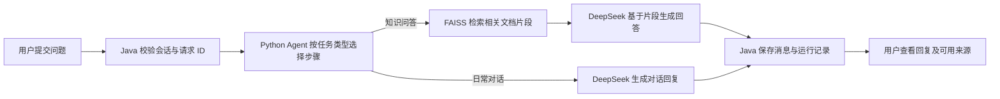
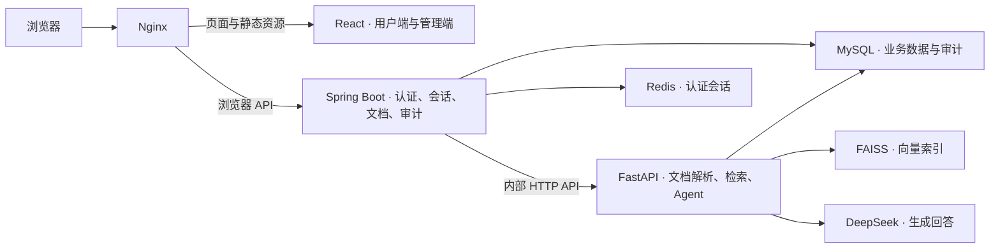

# DocTrail · 知径

**一个支持来源引用的文档问答系统，配有知识库管理和 Agent 运行追踪。**

管理员上传产品手册、技术文档或 FAQ 后，DocTrail 会解析文档并建立向量索引。用户可以用自然语言提问，查看回答依据的文档，并在历史会话中回看结果。管理员可以从运行记录中检查一次回答经过了哪些步骤、调用了哪些工具。

[快速启动](#快速启动) · [功能与实现](#功能与实现) · [系统架构](#系统架构) · [项目文档](#项目文档)

## 功能与实现

| 功能 | 项目中的实现 |
| --- | --- |
| 知识库问答 | 通过 Embedding 和 FAISS 检索相关片段，交给 DeepSeek 生成回答。回复下方按文档 ID 归并来源，同一份文档只显示一个来源标签。 |
| 会话管理 | 用户可以新建、重命名、删除会话，回看历史消息和引用。Java 按请求 ID 对重复问答请求做幂等处理。 |
| 文档管理 | 管理员可以上传和删除 PDF、DOCX、TXT、Markdown 文档，并查看异步解析状态。解析完成后，文档可用于问答。 |
| Agent 运行追踪 | Agent 按任务类型执行知识问答或日常对话。管理端可通过运行 ID 查看状态、执行步骤、工具调用和错误详情。 |
| 管理仪表盘 | 从 MySQL 汇总已处理完成的文档数、已结束的问答请求数和 Agent 运行总数。成功率以成功运行数除以已结束运行数。 |

### 一次知识问答如何完成



问答的步骤定义见 [Agent Planner](python-service/agent/planner.py)，文档来源的展示逻辑见 [ChatPage](frontend/src/pages/ChatPage.jsx)。管理端的统计口径见 [DashboardStatsMapper](src/main/java/com/doctrail/mapper/DashboardStatsMapper.java)。

## 系统架构



| 层 | 技术栈 |
| --- | --- |
| 前端 | React、Vite |
| 业务服务 | Java 21、Spring Boot、MyBatis-Plus、Flyway |
| AI 服务 | Python 3.11、FastAPI、LangChain、BAAI/bge-small-zh-v1.5、FAISS、DeepSeek |
| 数据与部署 | MySQL、Redis、Nginx、Docker Compose |

本地 Compose 环境只将 Nginx 绑定到宿主机的 `127.0.0.1`。MySQL 数据、上传文件、FAISS 索引和模型缓存由 Docker 命名卷保存。

## 快速启动

安装并启动 Docker Desktop，确认 Docker Compose 可用。下面以 Windows PowerShell 为例。

**1. 获取源码并创建配置文件**

```powershell
git clone https://github.com/hmwxbb6868/DocTrail.git
Set-Location DocTrail
if (-not (Test-Path -LiteralPath .env)) { Copy-Item .env.example .env }
notepad.exe .env
```

也可以下载源码 ZIP，在解压后的项目根目录执行最后两条命令。已有 `.env` 时直接编辑。按 [本地启动指南](docs/20-本地容器化启动与验收.md) 填写用户与管理员账号、服务密钥和 `DEEPSEEK_API_KEY`，并在项目根目录准备 `model-cache/`。指南提供使用 uv 下载并验证模型缓存的命令。

**2. 构建并启动**

```powershell
docker compose up -d --build --wait --wait-timeout 660
```

首次构建需要联网下载基础镜像和依赖。可用 `docker compose ps -a` 查看服务状态。带问题测试时，请使用可以发送给 DeepSeek 的内容，模型请求可能产生费用。

**3. 登录体验**

| 入口 | 体验步骤 |
| --- | --- |
| [管理端](http://127.0.0.1:8080/admin/login) | 用 `.env` 中配置的管理员账号登录，在「知识库管理」上传一份测试文档，等待状态变为「已完成」。 |
| [用户端](http://127.0.0.1:8080/login) | 用 `.env` 中配置的普通用户账号登录，提出一个能从该文档回答的问题。查看回复下方的来源，再从侧栏重新打开该会话。 |

最后回管理端的「Agent 运行记录」查看这次问答的步骤和工具调用。「仪表盘」会汇总已结束的请求与运行。如果同时登录两个角色，可在普通窗口和 InPrivate 窗口中分别打开。改过 `NGINX_HOST_PORT` 时，将上面的 `8080` 换成配置值。

## 项目结构

| 目录 | 职责 |
| --- | --- |
| [frontend/](frontend/) | 用户端、管理端与浏览器端测试 |
| [src/main/](src/main/) | Java 业务 API、认证、会话、文档管理、仪表盘与审计 |
| [python-service/](python-service/) | FastAPI、文档解析、向量检索与 Agent 执行 |
| [contracts/](contracts/) | 浏览器 API 与 Java–Python 内部 HTTP API 契约 |
| [docs/](docs/) | 开发环境、接口说明与本地交付指南 |

## 项目文档

- [本地启动与验证](docs/20-本地容器化启动与验收.md) · [本地开发环境](docs/02-环境搭建指南.md)
- [接口概览](docs/03-接口契约.md) · [浏览器 API](contracts/public-openapi.yaml) · [Java–Python 内部 API](contracts/ai-openapi.yaml)
- [错误码](docs/04-错误码表.md) · [依赖版本](docs/05-依赖版本清单.md) · [已知部署限制](docs/22-本地交付剩余风险评估.md)

## 来源与许可

DocTrail 的服务架构与核心功能参考了 EvanYao826 的 [AgentCraft](https://github.com/EvanYao826/AgentCraft)。DocTrail 在此基础上完善了接口契约、会话数据隔离、回答来源展示、Agent 审计、管理仪表盘和本地容器化交付。

项目采用 [Apache License 2.0](LICENSE)，归属与声明见 [NOTICE](NOTICE)。
