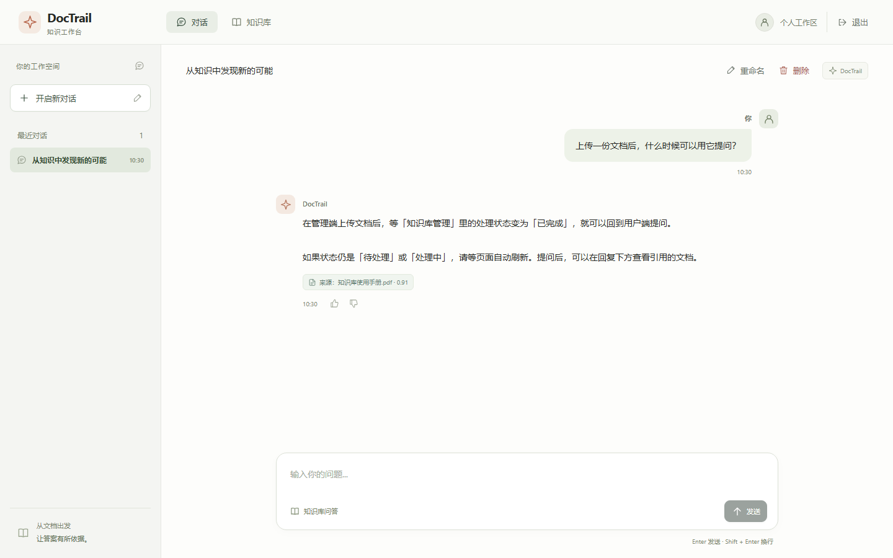
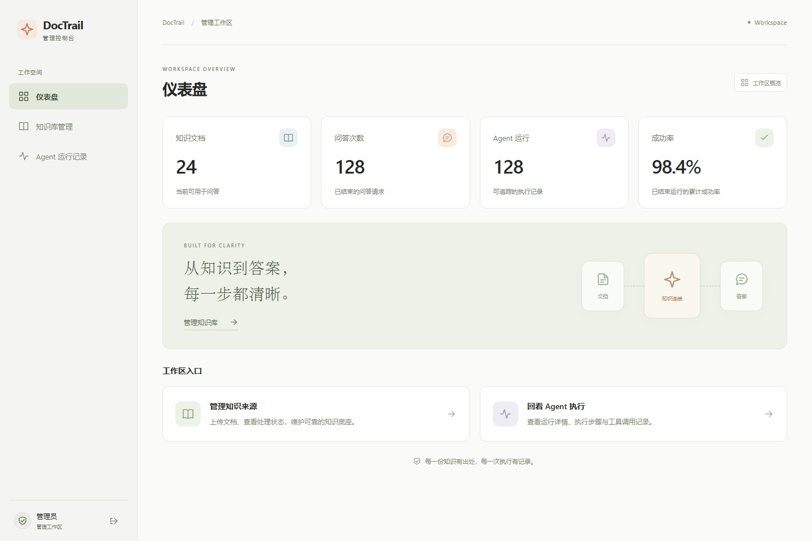
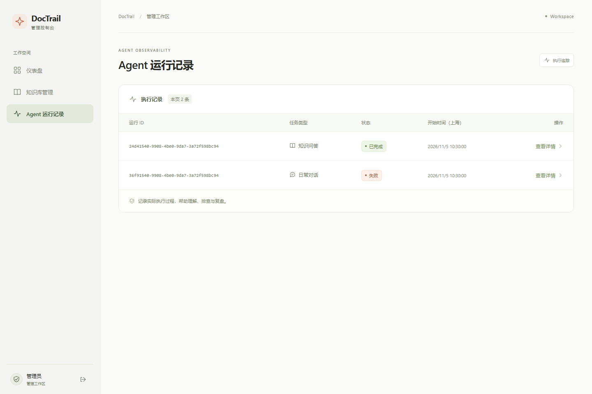
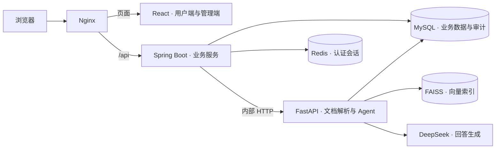

<h1 align="center">DocTrail · 知径</h1>

<p align="center"><strong>知识库问答 · 文档管理 · Agent 运行追踪</strong></p>

<p align="center">
  
  
  
  
  <a href="LICENSE"></a>
</p>

<p align="center">
  <a href="#界面预览">界面预览</a> ·
  <a href="#快速启动">快速启动</a> ·
  <a href="#系统架构">系统架构</a> ·
  <a href="#实现细节">实现细节</a> ·
  <a href="#项目文档">项目文档</a>
</p>

DocTrail 是一个可在本机用 Docker Compose 启动的文档问答系统。管理员上传产品手册、技术文档或 FAQ，用户用自然语言提问，在回复下方查看引用文件。一次问答结束后，管理员还能回看执行步骤和工具调用。

## 界面预览

**用户端 · 问答和文件引用**

[](docs/images/chat.png)

| 管理仪表盘 | Agent 运行记录 |
| :---: | :---: |
| [](docs/images/dashboard.png) | [](docs/images/agent-runs.png) |
| 查看文档数、问答数、运行数与成功率 | 查看任务类型、运行状态和详情 |

*截图取自 DocTrail 实际页面，问答、文档名和统计数字使用演示数据。点击图片可查看大图。*

## 快速启动

安装并启动 Docker Desktop。以下命令以 Windows PowerShell 为例。

**1. 下载源码并准备配置**

```powershell
git clone https://github.com/hmwxbb6868/DocTrail.git
Set-Location DocTrail
if (-not (Test-Path -LiteralPath .env)) { Copy-Item .env.example .env }
notepad.exe .env
```

在 `.env` 中填写用户与管理员账号、服务密钥和 `DEEPSEEK_API_KEY`，并在项目根目录准备 `model-cache/`。首次下载 Embedding 模型和校验缓存的命令见 [本地启动指南](docs/20-本地容器化启动与验收.md)。

**2. 构建并启动**

```powershell
docker compose up -d --build --wait --wait-timeout 660
```

首次构建需要联网下载镜像和依赖。用 `docker compose ps -a` 查看服务状态。若修改了 `NGINX_HOST_PORT`，访问时使用实际配置的端口。

**3. 跑通一次问答**

1. 登录 [管理端](http://127.0.0.1:8080/admin/login)，在「知识库管理」上传一份可用于演示的文档，等状态变为「已完成」。
2. 登录 [用户端](http://127.0.0.1:8080/login)，对该文档提问，查看回复下方的来源，再从侧栏打开原会话核对历史。模型请求可能产生费用。
3. 回到管理端的「Agent 运行记录」，打开本次知识问答，核对执行步骤和工具调用。

同时体验两种角色时，可分别使用普通窗口和隐私窗口。

## 系统架构



| 模块 | 职责 |
| --- | --- |
| [React / Vite](frontend/) | 用户对话、知识库浏览、管理仪表盘和 Agent 运行详情 |
| [Java 21 / Spring Boot](src/main/) | 登录与权限校验、会话和文档管理、请求去重、审计与统计 |
| [Python 3.11 / FastAPI](python-service/) | 解析和切分文档，用 BGE 生成 Embedding，检索 FAISS 并执行问答 |
| [Nginx / Docker Compose](docker-compose.yml) | 提供本地访问入口，通过命名卷保存 MySQL 数据、上传文件、索引和模型缓存 |

当前交付形态为本机 Docker Compose，默认只通过 `127.0.0.1:8080` 暴露 Nginx。浏览器使用同步问答接口。

## 实现细节

- **文档入库与引用**。支持 PDF、DOCX、TXT、Markdown。文档异步解析并建立索引。知识问答将检索到的文本片段交给 DeepSeek，界面按文档 ID 合并引用，避免同一文件重复显示。 [文档解析](python-service/core/parser.py) · [引用展示](frontend/src/pages/ChatPage.jsx)
- **问答路由与审计**。知识问答依次执行检索和生成，日常对话走独立的回复步骤。Java 用请求 ID 做幂等处理，并持久化 Agent 运行、步骤和工具调用。 [Agent 计划](python-service/agent/planner.py) · [问答服务](src/main/java/com/doctrail/service/impl/StageTwoMessageServiceImpl.java)
- **仪表盘口径**。文档数只统计已处理完成的文档，问答数统计已结束请求，成功率按「成功运行 ÷ 已结束运行」计算。 [统计查询](src/main/java/com/doctrail/mapper/DashboardStatsMapper.java)

## 项目文档

| 想了解 | 从这里开始 |
| --- | --- |
| 本地运行、排错与部署范围 | [启动及验证](docs/20-本地容器化启动与验收.md) · [已知部署限制](docs/22-本地交付剩余风险评估.md) |
| 本地开发 | [环境搭建](docs/02-环境搭建指南.md) · [依赖版本](docs/05-依赖版本清单.md) |
| API 与错误处理 | [接口概览](docs/03-接口契约.md) · [浏览器 API](contracts/public-openapi.yaml) · [内部 API](contracts/ai-openapi.yaml) · [错误码](docs/04-错误码表.md) |

## 来源与许可

DocTrail 的服务架构与核心功能参考了 EvanYao826 的 AgentCraft。在此基础上，DocTrail 完善了接口契约、会话数据隔离、引用展示、Agent 审计、仪表盘统计和本地容器化交付。 [AgentCraft](https://github.com/EvanYao826/AgentCraft)

项目采用 [Apache License 2.0](LICENSE)，归属与声明见 [NOTICE](NOTICE)。
